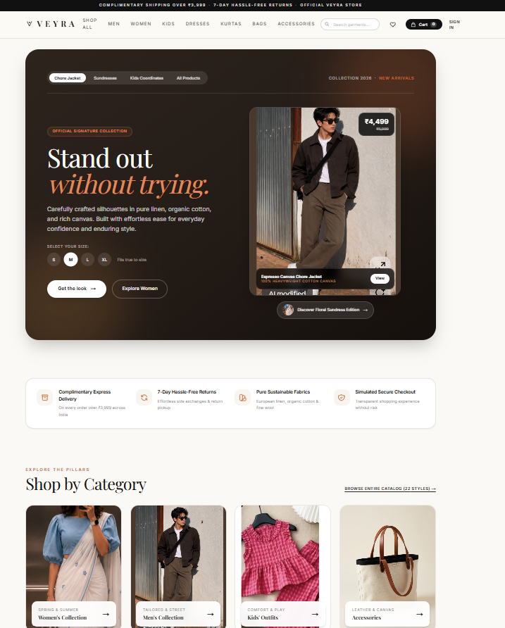
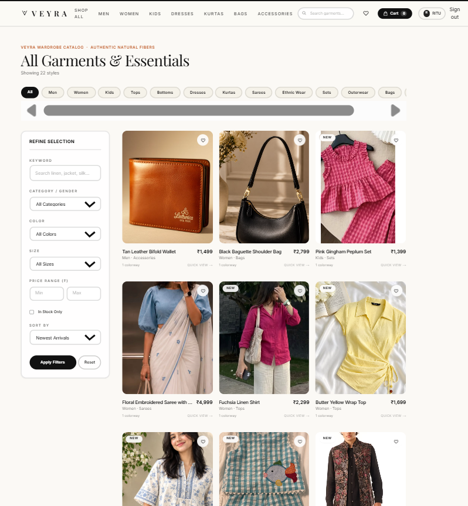
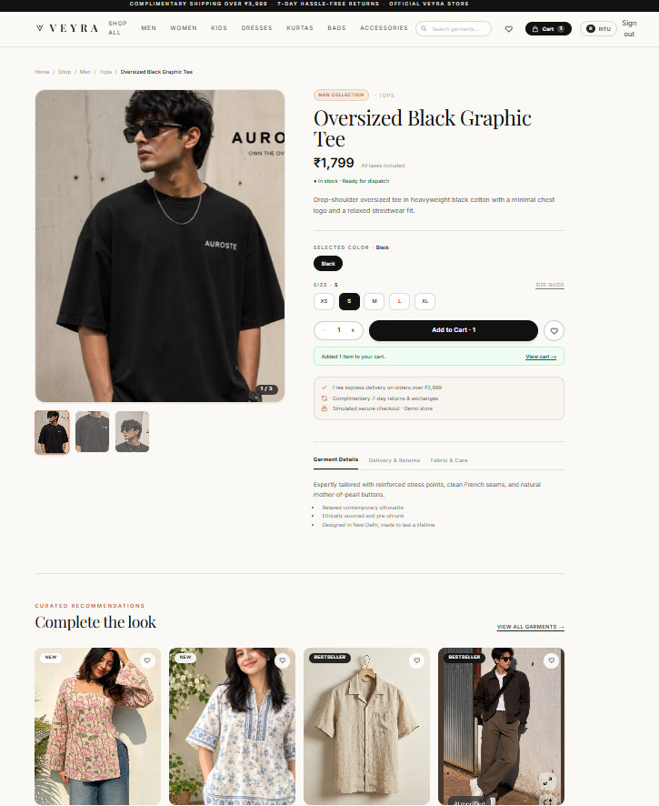

# VEYRA — Modern Style. Your Way.
Screenshots
<p align="center">
  
  
</p>
<p align="center">
  
</p>

A full-stack fashion e-commerce **demo** built with Next.js (App Router), TypeScript, Tailwind, Prisma and PostgreSQL.
Veyra is a fictional brand. Checkout is **simulated**: no payment is processed and no card data is collected.
Recommendations are **rule-based** (category / tag / size overlap), not generative AI.

## What you need (once)
- **Node.js 20 or newer** (LTS) from https://nodejs.org. Check with `node -v`.
- VS Code or Cursor. No other software, no paid services.

## Quick setup (easiest)
```
npm install
npm run setup
npm run dev
```
`npm run setup` creates `.env` (random secret + local demo admin `admin@veyra.test` / `ChangeMe123!`), the database and sample products. Change the admin password in `.env` before sharing anything.

## Manual setup (Windows PowerShell, macOS and Linux work the same)
Open the `veyra-store` folder in VS Code/Cursor, open the terminal (Ctrl+`) and run:

```powershell
# 1. Install packages (also generates the Prisma client)
npm install

# 2. Create your private settings file
copy .env.example .env          # macOS/Linux: cp .env.example .env
```

3. **Edit `.env`** and set `AUTH_SECRET` to a long random string. Generate one:
   ```powershell
   node -e "console.log(require('crypto').randomBytes(32).toString('hex'))"
   ```
   Paste the output between the quotes after `AUTH_SECRET=`. This secret signs your login cookies. Never share or commit it.

4. *(Optional, to use the admin dashboard)* In `.env` also fill `ADMIN_EMAIL` and `ADMIN_PASSWORD` (8+ characters), for example your own email and a throwaway password. They are only read by the seed script, only outside production, and never sent to the browser.

```powershell
# 5. Create the database (SQLite file at prisma/dev.db), apply migrations and add 18 sample products
npm run db:setup

# 6. Start the site
npm run dev
```
Open http://localhost:3000.

### What is Prisma / `.env`?
Prisma is the library that talks to the database. `prisma/schema.prisma` describes the tables; `npm run db:setup` turns it into a real SQLite file and creates a `prisma/migrations` folder (commit that folder to GitHub). `.env` holds secrets and is excluded by `.gitignore`.

## Try it
1. Click **Sign in → Create one** and register a customer account.
2. Browse **Shop**, search, filter, sort; open a product, pick a size, **Add to cart**, **Save** to the wishlist.
3. **Cart → Checkout → Place order** to see the confirmation, then **Account** for order history.
4. Sign in with the admin account from step 4 to see **Admin** in the header: edit prices/stock, add or delete products, change order status. Normal users get a 404 on `/admin` and 403 from the admin APIs.

Demo users: register through the UI. No real credentials are stored in the repo.

## Commands
| Command | Purpose |
|---|---|
| `npm run dev` | Start dev server |
| `npm run build` / `npm start` | Production build / run it |
| `npm run typecheck` | TypeScript check |
| `npm test` | Run automated tests (Vitest) |
| `npm run db:seed` | Re-run seed (idempotent; resets product stock/prices to seed values) |
| `npm run db:reset` | Wipe and recreate the database |

## Images
Products use built-in garment illustrations (they change with the selected color) by default. To add real photography, put your own licensed images in `public/products/` (for example `public/products/linen-shirt.jpg`) and set a product's image to `/products/linen-shirt.jpg` (admin "Add product" form, or Prisma Studio: `npx prisma studio`). If an image fails to load, the placeholder is shown.

## Project layout
- `prisma/` schema, seed
- `src/lib/` auth (signed HttpOnly cookie), validation (zod), pricing, recommendations, API helpers
- `src/app/api/` route handlers (auth, cart, wishlist, checkout, admin)
- `src/app/` pages; `src/components/` UI
- `tests/` Vitest tests

## Security notes
Passwords are hashed with bcrypt (`bcryptjs`, 12 rounds). Sessions are signed JWTs in HttpOnly, SameSite=Lax cookies. All input is validated server-side; prices and totals are computed on the server from the database; stock is checked and decremented inside a transaction; orders are scoped to the signed-in user; admin routes check the role on the server. This is a portfolio project: it has no rate limiting, email verification or real payments, and is **not** production-grade security.

## Currency
Prices are stored in paise and shown in Indian Rupees (₹). Free shipping applies at ₹3,999 and above; otherwise shipping is ₹149. After pulling updated seed prices, run `npm run db:seed`.

## Health check
If sign-up or sign-in fails, run `npm run doctor`. In development the error message is also shown on the form.

## Common errors
- **"AUTH_SECRET is missing or shorter than 32 characters"**: do step 3, then restart `npm run dev`.
- **"Environment variable not found: DATABASE_URL"**: `.env` does not exist. Do step 2.
- **`The table main.Product does not exist`**: run `npm run db:setup`.
- **`EPERM ... query_engine` on Windows**: stop `npm run dev`, then rerun the command.
- **Port 3000 in use**: `npm run dev -- -p 3001`.
- **Cannot sign in as admin**: set ADMIN_EMAIL/ADMIN_PASSWORD in `.env`, run `npm run db:seed`.
